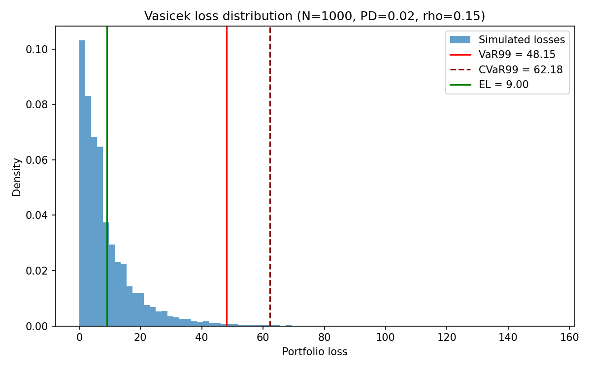
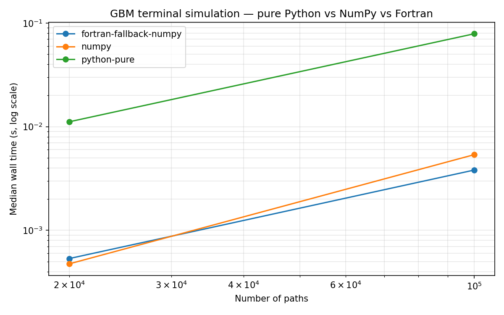

[](https://github.com/carlosedurampz-sketch/StochasticQuant-F90/actions/workflows/ci.yml)
[](https://www.python.org/)
[](fortran/montecarlo.f90)
[](LICENSE)

# StochasticQuant-F90 — Riesgo de cola y procesos estocásticos híbridos

[Read the English version](README.md)

Motor cuantitativo para simular el riesgo de cola de una cartera de crédito y la valuación de activos bajo incertidumbre, combinando Python con un núcleo numérico compilado en Fortran 90. Modela incumplimientos correlacionados con el modelo estructural de Merton y el modelo unifactorial de Vasicek (descomposición de Cholesky), y la dinámica de mercado con movimiento browniano geométrico (GBM) y volatilidad estocástica de Heston, resueltos con los esquemas de Euler–Maruyama y Milstein. Calcula VaR y Expected Shortfall (CVaR), valida el modelo con la prueba de cobertura de Kupiec y compara los tiempos de ejecución entre Python puro, NumPy vectorizado y Fortran 90. **Todos los datos son sintéticos y simulados (semillas fijas); los resultados son ilustrativos y sirven para validar la numeración — no describen ninguna cartera ni exposición real.**

## Qué hace

| Bloque | Modelo | Archivo |
|---|---|---|
| Incumplimientos correlacionados | Modelo estructural de Merton (1974), matriz de correlación completa vía Cholesky | `src/models.py`, `fortran/montecarlo.f90` |
| Incumplimientos correlacionados | Modelo unifactorial de Vasicek (1987/2002), VaR asintótico en forma cerrada | `src/models.py` |
| Dinámica de mercado | GBM — exacto, Euler–Maruyama, Milstein | `src/models.py` |
| Dinámica de mercado | Heston (1993), volatilidad estocástica, Euler / Milstein con truncamiento completo | `src/models.py` |
| Riesgo de cola | VaR$_\alpha$, Expected Shortfall (CVaR$_\alpha$) | `src/risk_metrics.py` |
| Validación | Prueba de cobertura incondicional de Kupiec (1995) | `src/risk_metrics.py` |
| Reducción de varianza | Variables antitéticas, variables de control (Black–Scholes) | `fortran/montecarlo.f90` |
| Rendimiento | Benchmark Python puro vs NumPy vs Fortran | `src/benchmark.py` |

## Matemáticas

### Modelo estructural de Merton

El valor de los activos de la empresa sigue un GBM, $dV = \mu V\,dt + \sigma V\,dW$. Hay incumplimiento en el horizonte $T$ si $V_T < D$ (deuda):

$$d_2 = \frac{\ln(V_0/D) + (\mu - \sigma^2/2)T}{\sigma\sqrt{T}}, \qquad PD = \Phi(-d_2)$$

Incumplimientos correlacionados: los rendimientos estandarizados de los activos $X \sim \mathcal{N}(0, \Sigma)$ se generan como $X = L Z$, con $L$ el factor de Cholesky, $\Sigma = LL^\top$; el acreditado $i$ incumple si $X_i < \Phi^{-1}(PD_i)$.

### Modelo unifactorial de Vasicek

Condicionado a un factor sistémico $Y \sim \mathcal{N}(0,1)$,

$$p(Y) = \Phi\left(\frac{\Phi^{-1}(PD) - \sqrt{\rho}\,Y}{\sqrt{1-\rho}}\right), \qquad \text{incumplimientos} \mid Y \sim \mathrm{Binomial}(N, p(Y))$$

La pérdida esperada es exacta: $\mathbb{E}[L] = N \cdot PD \cdot LGD \cdot EAD$. En el límite de cartera homogénea grande ($N \to \infty$), el VaR tiene forma cerrada — la fórmula IRB de Basilea II — que se usa aquí como objetivo de validación:

$$\mathrm{VaR}_\alpha = N \cdot LGD \cdot EAD \cdot \Phi\left(\frac{\Phi^{-1}(PD) + \sqrt{\rho}\,\Phi^{-1}(\alpha)}{\sqrt{1-\rho}}\right)$$

### GBM y Heston

$$dS_t = \mu S_t\,dt + \sigma S_t\,dW_t \quad\text{(GBM)}, \qquad S_T = S_0 e^{(\mu-\sigma^2/2)T + \sigma\sqrt{T}Z}$$

$$\begin{aligned}
dS_t &= \mu S_t\,dt + \sqrt{v_t}\,S_t\,dW_t^{(1)} \\
dv_t &= \kappa(\theta - v_t)\,dt + \xi\sqrt{v_t}\,dW_t^{(2)}, \quad \mathrm{corr}(dW^{(1)}, dW^{(2)}) = \rho
\end{aligned} \quad\text{(Heston)}$$

Discretización, paso $h$: Euler–Maruyama $S_{t+h} = S_t + \mu S_t h + \sigma S_t\sqrt{h}\,Z$ (orden fuerte 0.5); Milstein agrega $\tfrac12 \sigma^2 S_t (h Z^2 - h)$ (orden fuerte 1.0 para GBM). Heston usa truncamiento completo, $v^+ = \max(v, 0)$, por lo que la varianza nunca se vuelve negativa aun cuando falla la condición de Feller $2\kappa\theta > \xi^2$.

### VaR, Expected Shortfall, Kupiec

$$\mathrm{VaR}_\alpha = q_\alpha(L), \qquad \mathrm{CVaR}_\alpha = \mathbb{E}[L \mid L > \mathrm{VaR}_\alpha]$$

Prueba POF de Kupiec: con $x$ violaciones en $n$ observaciones y $p = 1-\alpha$,

$$LR = -2\ln\left[\frac{(1-p)^{n-x} p^{x}}{(1-x/n)^{n-x}(x/n)^{x}}\right] \sim \chi^2_1 \quad \text{bajo } H_0$$

### Reducción de varianza

- **Variables antitéticas:** cada sorteo $Z$ se empareja con $-Z$; el promedio cancela el error de Monte Carlo de primer orden para payoffs simétricos.
- **Variables de control:** para una call europea, el precio terminal $S_T$ se usa como control, ya que $\mathbb{E}[S_T] = S_0 e^{\mu T}$ es conocido; el estimador es $\hat{P}_{CV} = \hat{P} - \hat\beta(\bar S_T - \mathbb{E}[S_T])$, con $\hat\beta$ de la covarianza muestral. El precio analítico de Black–Scholes es la referencia.

## Arquitectura

```
StochasticQuant-F90/
├── fortran/montecarlo.f90   # Núcleo F90: Box-Muller, Cholesky, GBM, Vasicek,
│                            #   Merton, variables de control, VaR/CVaR (quicksort)
├── src/
│   ├── models.py            # Merton, Vasicek, GBM, Heston (NumPy)
│   ├── risk_metrics.py      # VaR, CVaR, Kupiec, VaR/CVaR analítico normal
│   ├── fortran_backend.py   # UNA API: f2py compilado si existe, si no NumPy
│   ├── run_simulation.py    # Ejecución end-to-end + controles de validación
│   └── benchmark.py         # Python puro vs NumPy vs Fortran
├── scripts/
│   ├── convergence.py       # VaR/CVaR vs escenarios; error de Euler vs Milstein
│   └── backtest.py          # Kupiec: modelo bueno aceptado, modelo malo rechazado
├── docs/images/             # Gráficas incrustadas en los READMEs
├── notebooks/convergence_and_backtesting.ipynb
├── tests/                   # pytest: verdades analíticas (ver abajo)
├── results/                 # Generado, ignorado por git (summary.json, *.png, *.csv)
├── .github/workflows/ci.yml # CI: gfortran + make fortran + pytest
├── Makefile  run_all.sh  requirements.txt  LICENSE (MIT)
```

## Inicio rápido

```bash
git clone https://github.com/carlosedurampz-sketch/StochasticQuant-F90.git
cd StochasticQuant-F90
pip install -r requirements.txt
python -m pytest tests/ -q        # 12 pruebas, todas con verdades analíticas
python -m src.run_simulation      # Ejecución principal (ver Resultados)
python -m src.benchmark           # Comparación de tiempos
python scripts/convergence.py     # Convergencia + error de esquemas
python scripts/backtest.py        # Backtest de Kupiec
# ... o todo a la vez:
./run_all.sh
```

### Con Fortran (recomendado — es el punto del proyecto)

```bash
# Ubuntu/Debian: sudo apt-get install gfortran
make fortran
python -c "import sys; sys.path.insert(0,'src'); from fortran_backend import FORTRAN_AVAILABLE; print('Fortran:', FORTRAN_AVAILABLE)"
python -m src.run_simulation   # el backend ahora reporta "fortran"
```

### Sin Fortran

Sin compilador no hay problema: `src/fortran_backend.py` detecta la
ausencia del `.so` y ejecuta la implementación en NumPy con las **mismas
firmas de función**, reportando `backend: "numpy-fallback"`. Todos los
scripts, pruebas y benchmarks corren igual; el benchmark etiqueta ese
motor como `fortran-fallback-numpy` en lugar de fingir que es Fortran.
El CI (`.github/workflows/ci.yml`) instala `gfortran` y ejecuta
`make fortran` antes de `pytest`, por lo que el núcleo compilado se
ejercita en cada push.

## Resultados (ilustrativos — datos sintéticos, semilla 42)

Caso principal: $N = 1{,}000$ acreditados, $PD = 2\%$, $\rho = 0.15$, $LGD = 45\%$, $EAD = 1$, 50,000 escenarios, variables antitéticas. Todas las cifras se reproducen con `python -m src.run_simulation` y se guardan en `results/summary.json`.

| Cantidad | Valor |
|---|---|
| Pérdida esperada, simulada | **9.015** |
| Pérdida esperada, teoría $N\cdot PD\cdot LGD\cdot EAD$ | 9.00 |
| VaR$_{95}$ / CVaR$_{95}$ (Vasicek) | 28.80 / 41.35 |
| VaR$_{99}$ (Vasicek, simulado) | **48.15** |
| CVaR$_{99}$ (Vasicek, simulado) | **62.18** |
| VaR$_{99}$, límite analítico de Vasicek | 47.51 (simulación dentro del 1.3%) |
| VaR$_{99}$ / CVaR$_{99}$ vía la API de Fortran | 48.15 / 62.18 (idéntico — mismo modelo; motor de respaldo en NumPy donde no hay compilador) |
| EL / VaR$_{99}$ / CVaR$_{99}$ de Merton (misma PD = 2%) | 9.01 / 47.70 / 62.30 |
| Kupiec VaR$_{99}$: violaciones 487/50,000 (0.97% vs 1% esperado) | LR = 0.34, p = 0.557 → H₀ no se rechaza |
| Media terminal de GBM, exacto / Euler / Milstein vs teoría 105.13 | 105.06 / 105.06 / 105.06 |
| Media terminal de Heston, precio / varianza media (θ = 0.04) | 105.07 / 0.0399 |
| Tiempo de la ejecución completa | ~11 s (tras optimizar la ruta de Merton con equicorrelación de $O(N_{scen}N^2)$ a $O(N_{scen}N)$ — antes era 193 s) |



Figuras adicionales: `results/gbm_heston.png` (trayectorias de ejemplo) y `results/convergence.png` (convergencia de VaR/CVaR).

## Validación — cómo sé que los números son correctos

Cada verificación siguiente está automatizada (`pytest`, más controles de aserción dentro de `run_simulation.py` que fallan ruidosamente en lugar de publicar un número incorrecto):

1. **VaR/CVaR sobre una distribución conocida.** Para pérdidas $N(0,1)$, VaR$_{99}$ = 2.3263 y CVaR$_{99}$ = 2.6652 analíticamente; la simulación coincide dentro del error de Monte Carlo (`tests/test_risk_metrics.py`).
2. **Cholesky reconstruye la correlación.** $L L^\top = \Sigma$ hasta $10^{-10}$; una matriz no definida positiva se rechaza (`tests/test_models.py`).
3. **La PD de Merton coincide con la forma cerrada** ($V_0=100$, $D=80$ → $PD = 0.167$).
4. **Identidad de la pérdida esperada.** La EL simulada coincide con $N\cdot PD\cdot LGD\cdot EAD = 9.00$ dentro de $5\times$ el error estándar de Monte Carlo.
5. **El VaR converge al límite analítico de Vasicek** (dentro del 10% con 100k escenarios; ver `scripts/convergence.py` — el error decrece como $1/\sqrt{N}$).
6. **Esquemas de GBM.** La media terminal coincide con $S_0 e^{\mu T} = 105.13$ para exacto/Euler/Milstein; la varianza de Heston revierte a $\theta = 0.04$ y nunca es negativa.
7. **Kupiec tiene potencia.** *Acepta* un modelo VaR normal bien especificado y *rechaza* el mismo VaR aplicado a pérdidas Student-$t_3$ de colas pesadas (`scripts/backtest.py`).

## Benchmark

`python -m src.benchmark` mide la simulación terminal de GBM (20k y 100k trayectorias, mediana de 3 repeticiones) para bucles en Python puro, vectorización con NumPy y el núcleo de Fortran. Medido en GitHub Actions (CI run #5, `ubuntu-latest`, Python 3.11, 20 nov 2026), tiempo de pared mediano:

| Motor | 20,000 trayectorias | 100,000 trayectorias |
|---|---|---|
| Python puro | 0.0093 s | 0.0443 s |
| NumPy | 0.0002 s | 0.0011 s |
| Fortran (f2py) | 0.0010 s | 0.0048 s |

NumPy es **40× más rápido que Python puro** con 100k trayectorias. Fortran es **9.2× más rápido que Python puro** pero ~4× más lento que NumPy aquí — y la comparación no es directa: el motor Fortran simula la trayectoria completa de 252 pasos por cada trayectoria, mientras que NumPy y Python puro calculan solo el valor terminal en un paso con la fórmula cerrada. Por paso simulado, Fortran va muy por delante; NumPy gana el atajo del valor terminal porque ya está cerca del límite vectorizado. Esa asimetría es en sí misma la lección: Fortran destaca en los núcleos de Vasicek/Merton, intensivos en bucles, mientras que para el núcleo vectorizable de GBM NumPy ya está cerca del límite. El benchmark corre en CI en cada push (ver `.github/workflows/ci.yml`), así que estos números se re-miden, no son de una sola corrida. Ver `results/benchmark.csv`.



## Datos

**En este repositorio no se usa ningún dato real.** Las carteras son sintéticas (Monte Carlo con semillas y parámetros declarados), las trayectorias de mercado son simuladas y los backtests usan series de rendimientos simuladas. Nada aquí describe un acreditado real, una cartera real ni historia real de mercado, y ningún resultado debe usarse para una decisión real de crédito o trading. Los parámetros (PD = 2%, $\rho$ = 0.15, LGD = 45%) son valores típicos de libro elegidos para que las verificaciones analíticas sean significativas.

## Limitaciones conocidas

- El núcleo de Vasicek en Fortran usa una binomial exacta para $N \le 500$ y una aproximación normal a la binomial por encima de ese valor (error relativo $O(1/N)$); la implementación en Python usa la binomial exacta para todo $N$. Ambas coinciden dentro del error de Monte Carlo — ver el VaR de la API de Fortran en `results/summary.json` — pero no son idénticas bit a bit.
- Heston usa Euler/Milstein con truncamiento completo, no el esquema exacto de Broadie–Kaya; el sesgo de discretización es visible con pocos pasos (ver `scripts/convergence.py`).
- El VaR/CVaR aquí es incondicional, de un periodo, y supone la estructura de correlación declarada; no hay estructura temporal, ni LGD estocástica, ni riesgo de wrong-way.
- El núcleo compilado de Fortran se construye y prueba en CI (`gfortran` + `make fortran` antes de `pytest`); la interfaz f2py sigue la convención documentada de f2py, y el respaldo en NumPy reproduce la misma API donde no hay compilador disponible.

## Autor y licencia

Creado por **Carlos Eduardo Ramírez Pérez** — Físico (UAM) enfocado en modelado cuantitativo, analítica de riesgo y ciencia de datos. Licencia MIT.
