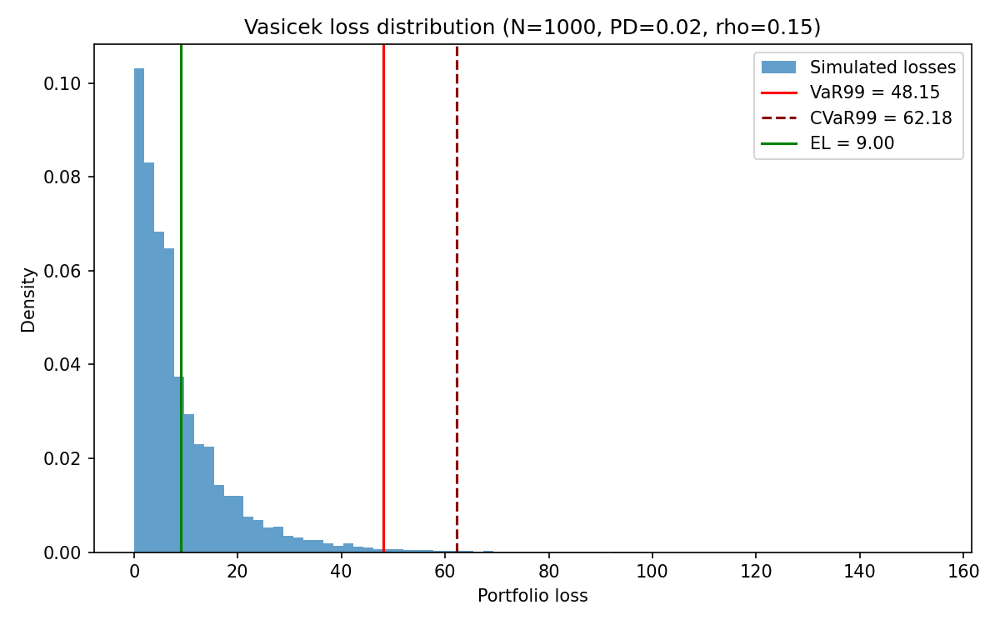
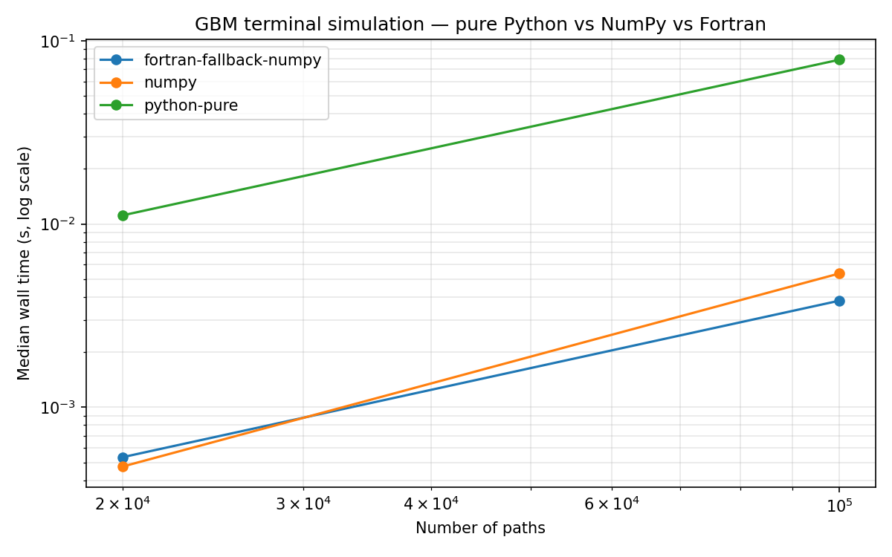

[](https://github.com/carlosedurampz-sketch/StochasticQuant-F90/actions/workflows/ci.yml)
[](https://www.python.org/)
[](fortran/montecarlo.f90)
[](LICENSE)

# StochasticQuant-F90 — Tail Risk & Hybrid Stochastic Processes

[Read the Spanish version](README.es.md)

A quantitative engine for simulating the tail risk of a credit portfolio and asset valuation under uncertainty, combining Python with a compiled Fortran 90 numerical core. It models correlated defaults with the Merton structural model and the Vasicek single-factor model (Cholesky decomposition), and market dynamics with geometric Brownian motion (GBM) and Heston stochastic volatility, solved with Euler–Maruyama and Milstein schemes. It computes VaR and Expected Shortfall (CVaR), validates the model with the Kupiec coverage test, and benchmarks execution time across pure Python, vectorised NumPy, and Fortran 90. **All data is synthetic and simulated (fixed seeds); results are illustrative and validate the numerics — they do not describe any real portfolio or exposure.**

## What it does

| Block | Model | File |
|---|---|---|
| Correlated defaults | Merton (1974) structural model, full correlation matrix via Cholesky | `src/models.py`, `fortran/montecarlo.f90` |
| Correlated defaults | Vasicek (1987/2002) single-factor model, asymptotic VaR in closed form | `src/models.py` |
| Market dynamics | GBM — exact, Euler–Maruyama, Milstein | `src/models.py` |
| Market dynamics | Heston (1993) stochastic volatility, full-truncation Euler / Milstein | `src/models.py` |
| Tail risk | VaR$_\alpha$, Expected Shortfall (CVaR$_\alpha$) | `src/risk_metrics.py` |
| Validation | Kupiec (1995) unconditional-coverage test | `src/risk_metrics.py` |
| Variance reduction | Antithetic variates, control variates (Black–Scholes) | `fortran/montecarlo.f90` |
| Performance | Pure Python vs NumPy vs Fortran benchmark | `src/benchmark.py` |

## Mathematics

### Merton structural model

Firm asset value follows GBM, $dV = \mu V\,dt + \sigma V\,dW$. Default by horizon $T$ iff $V_T < D$ (debt):

$$d_2 = \frac{\ln(V_0/D) + (\mu - \sigma^2/2)T}{\sigma\sqrt{T}}, \qquad PD = \Phi(-d_2)$$

Correlated defaults: standardised asset returns $X \sim \mathcal{N}(0, \Sigma)$ are drawn as $X = L Z$ with $L$ the Cholesky factor, $\Sigma = LL^\top$; obligor $i$ defaults iff $X_i < \Phi^{-1}(PD_i)$.

### Vasicek single-factor model

Conditional on a systemic factor $Y \sim \mathcal{N}(0,1)$,

$$p(Y) = \Phi\left(\frac{\Phi^{-1}(PD) - \sqrt{\rho}\,Y}{\sqrt{1-\rho}}\right), \qquad \text{defaults} \mid Y \sim \mathrm{Binomial}(N, p(Y))$$

Expected loss is exact: $\mathbb{E}[L] = N \cdot PD \cdot LGD \cdot EAD$. In the large-homogeneous-portfolio limit ($N \to \infty$) VaR has a closed form — the Basel II IRB formula — used here as a validation target:

$$\mathrm{VaR}_\alpha = N \cdot LGD \cdot EAD \cdot \Phi\left(\frac{\Phi^{-1}(PD) + \sqrt{\rho}\,\Phi^{-1}(\alpha)}{\sqrt{1-\rho}}\right)$$

### GBM and Heston

$$dS_t = \mu S_t\,dt + \sigma S_t\,dW_t \quad\text{(GBM)}, \qquad S_T = S_0 e^{(\mu-\sigma^2/2)T + \sigma\sqrt{T}Z}$$

$$\begin{aligned}
dS_t &= \mu S_t\,dt + \sqrt{v_t}\,S_t\,dW_t^{(1)} \\
dv_t &= \kappa(\theta - v_t)\,dt + \xi\sqrt{v_t}\,dW_t^{(2)}, \quad \mathrm{corr}(dW^{(1)}, dW^{(2)}) = \rho
\end{aligned} \quad\text{(Heston)}$$

Discretisation, step $h$: Euler–Maruyama $S_{t+h} = S_t + \mu S_t h + \sigma S_t\sqrt{h}\,Z$ (strong order 0.5); Milstein adds $\tfrac12 \sigma^2 S_t (h Z^2 - h)$ (strong order 1.0 for GBM). Heston uses full truncation, $v^+ = \max(v, 0)$, so variance never goes negative even when the Feller condition $2\kappa\theta > \xi^2$ fails.

### VaR, Expected Shortfall, Kupiec

$$\mathrm{VaR}_\alpha = q_\alpha(L), \qquad \mathrm{CVaR}_\alpha = \mathbb{E}[L \mid L > \mathrm{VaR}_\alpha]$$

Kupiec's POF test: with $x$ violations in $n$ observations and $p = 1-\alpha$,

$$LR = -2\ln\left[\frac{(1-p)^{n-x} p^{x}}{(1-x/n)^{n-x}(x/n)^{x}}\right] \sim \chi^2_1 \quad \text{under } H_0$$

### Variance reduction

- **Antithetic variates:** each draw $Z$ is paired with $-Z$; the average cancels first-order Monte Carlo error for symmetric payoffs.
- **Control variates:** for a European call, the terminal price $S_T$ is used as control, since $\mathbb{E}[S_T] = S_0 e^{\mu T}$ is known; the estimator is $\hat{P}_{CV} = \hat{P} - \hat\beta(\bar S_T - \mathbb{E}[S_T])$, with $\hat\beta$ from the sample covariance. The analytic Black–Scholes price is the reference.

## Architecture

```
StochasticQuant-F90/
├── fortran/montecarlo.f90   # F90 core: Box-Muller, Cholesky, GBM, Vasicek,
│                            #   Merton, control variates, VaR/CVaR (quicksort)
├── src/
│   ├── models.py            # Merton, Vasicek, GBM, Heston (NumPy)
│   ├── risk_metrics.py      # VaR, CVaR, Kupiec, analytic normal VaR/CVaR
│   ├── fortran_backend.py   # ONE API: compiled f2py if present, else NumPy
│   ├── run_simulation.py    # end-to-end run + validation gates
│   └── benchmark.py         # pure Python vs NumPy vs Fortran
├── scripts/
│   ├── convergence.py       # VaR/CVaR vs scenarios; Euler vs Milstein error
│   └── backtest.py          # Kupiec: good model accepted, bad model rejected
├── docs/images/             # charts embedded in the READMEs
├── notebooks/convergence_and_backtesting.ipynb
├── tests/                   # pytest: analytic ground truths (see below)
├── results/                 # generated, git-ignored (summary.json, *.png, *.csv)
├── .github/workflows/ci.yml # CI: gfortran + make fortran + pytest
├── Makefile  run_all.sh  requirements.txt  LICENSE (MIT)
```

## Quickstart

```bash
git clone https://github.com/carlosedurampz-sketch/StochasticQuant-F90.git
cd StochasticQuant-F90
pip install -r requirements.txt
python -m pytest tests/ -q        # 12 tests, all analytic ground truths
python -m src.run_simulation      # headline run (see Results)
python -m src.benchmark           # timing comparison
python scripts/convergence.py     # convergence + scheme error
python scripts/backtest.py        # Kupiec backtest
# ... or everything at once:
./run_all.sh
```

### With Fortran (recommended — this is the point of the project)

```bash
# Ubuntu/Debian: sudo apt-get install gfortran
make fortran
python -c "import sys; sys.path.insert(0,'src'); from fortran_backend import FORTRAN_AVAILABLE; print('Fortran:', FORTRAN_AVAILABLE)"
python -m src.run_simulation   # backend now reports "fortran"
```

### Without Fortran

No compiler, no problem: `src/fortran_backend.py` detects the missing
`.so` and runs the NumPy implementation behind the **same function
signatures**, reporting `backend: "numpy-fallback"`. All scripts, tests
and benchmarks run identically; the benchmark labels that engine
`fortran-fallback-numpy` instead of pretending it is Fortran. CI
(`.github/workflows/ci.yml`) installs `gfortran` and runs `make fortran`
before `pytest`, so the compiled core is exercised on every push.

## Results (illustrative — synthetic data, seed 42)

Headline case: $N = 1{,}000$ obligors, $PD = 2\%$, $\rho = 0.15$, $LGD = 45\%$, $EAD = 1$, 50,000 scenarios, antithetic variates. All figures are reproduced by `python -m src.run_simulation` and stored in `results/summary.json`.

| Quantity | Value |
|---|---|
| Expected loss, simulated | **9.015** |
| Expected loss, theory $N\cdot PD\cdot LGD\cdot EAD$ | 9.00 |
| VaR$_{95}$ / CVaR$_{95}$ (Vasicek) | 28.80 / 41.35 |
| VaR$_{99}$ (Vasicek, simulated) | **48.15** |
| CVaR$_{99}$ (Vasicek, simulated) | **62.18** |
| VaR$_{99}$, analytic Vasicek limit | 47.51 (simulation within 1.3%) |
| VaR$_{99}$ / CVaR$_{99}$ via the Fortran API | 48.15 / 62.18 (identical — same model; NumPy fallback engine where no compiler is present) |
| Merton EL / VaR$_{99}$ / CVaR$_{99}$ (same PD = 2%) | 9.01 / 47.70 / 62.30 |
| Kupiec VaR$_{99}$: violations 487/50,000 (0.97% vs 1% expected) | LR = 0.34, p = 0.557 → H₀ not rejected |
| GBM terminal mean, exact / Euler / Milstein vs theory 105.13 | 105.06 / 105.06 / 105.06 |
| Heston terminal mean price / mean variance (θ = 0.04) | 105.07 / 0.0399 |
| Runtime of the full run | ~11 s (after optimising the equicorrelation Merton path from $O(N_{scen}N^2)$ to $O(N_{scen}N)$ — it was 193 s before) |



Additional figures: `results/gbm_heston.png` (sample paths) and `results/convergence.png` (VaR/CVaR convergence).

## Validation — how I know the numbers are right

Every check below is automated (`pytest`, plus assertion gates inside `run_simulation.py` that fail loudly instead of publishing a wrong number):

1. **VaR/CVaR on a known distribution.** For $N(0,1)$ losses, VaR$_{99}$ = 2.3263 and CVaR$_{99}$ = 2.6652 analytically; the simulation matches to Monte Carlo error (`tests/test_risk_metrics.py`).
2. **Cholesky reconstructs correlation.** $L L^\top = \Sigma$ to $10^{-10}$; a non-positive-definite matrix is rejected (`tests/test_models.py`).
3. **Merton PD matches the closed form** ($V_0=100$, $D=80$ → $PD = 0.167$).
4. **Expected-loss identity.** Simulated EL matches $N\cdot PD\cdot LGD\cdot EAD = 9.00$ within $5\times$ Monte Carlo standard error.
5. **VaR converges to the analytic Vasicek limit** (within 10% at 100k scenarios; see `scripts/convergence.py` — error shrinks like $1/\sqrt{N}$).
6. **GBM schemes.** Terminal mean matches $S_0 e^{\mu T} = 105.13$ for exact/Euler/Milstein; Heston variance reverts to $\theta = 0.04$ and never goes negative.
7. **Kupiec has power.** It *accepts* a well-specified normal VaR model and *rejects* the same VaR applied to heavy-tailed Student-$t_3$ losses (`scripts/backtest.py`).

## Benchmark

`python -m src.benchmark` times GBM terminal simulation (20k and 100k paths, median of 3 runs) for pure Python loops, NumPy vectorisation, and the Fortran core. Measured in GitHub Actions (CI run #5, `ubuntu-latest`, Python 3.11, 20 Nov 2026), median wall time:

| Engine | 20,000 paths | 100,000 paths |
|---|---|---|
| Pure Python | 0.0093 s | 0.0443 s |
| NumPy | 0.0002 s | 0.0011 s |
| Fortran (f2py) | 0.0010 s | 0.0048 s |

NumPy is **40× faster than pure Python** at 100k paths. Fortran is **9.2× faster than pure Python** but ~4× slower than NumPy here — and the comparison is not like-for-like: the Fortran engine simulates the full 252-step path for every trajectory, while NumPy and pure Python compute only the terminal value in one closed-form step. Per simulated step, Fortran is far ahead; NumPy wins the terminal-value shortcut because it is already near the vectorised limit. That asymmetry is itself the lesson: Fortran pulls ahead on the loop-heavy Vasicek/Merton kernels, while for the vectorisable GBM kernel NumPy is already near the limit. The benchmark runs in CI on every push (see `.github/workflows/ci.yml`), so these numbers are re-measured, not one-off. See `results/benchmark.csv`.



## Data

**No real data is used anywhere in this repository.** Portfolios are synthetic (seeded Monte Carlo with stated parameters), market paths are simulated, and backtests use simulated return series. Nothing here describes a real obligor, a real portfolio, or real market history, and no result should be used for an actual credit or trading decision. Parameters (PD = 2%, $\rho$ = 0.15, LGD = 45%) are textbook-typical values chosen to make the analytic cross-checks meaningful.

## Known limitations

- The Fortran Vasicek kernel uses an exact binomial for $N \le 500$ and a normal approximation to the binomial above that (relative error $O(1/N)$); the Python implementation uses the exact binomial for every $N$. The two agree within Monte Carlo error — see the Fortran-API VaR in `results/summary.json` — but they are not bit-identical.
- Heston uses full-truncation Euler/Milstein, not the exact Broadie–Kaya scheme; discretisation bias is visible at few steps (see `scripts/convergence.py`).
- VaR/CVaR here are unconditional, one-period, and assume the stated correlation structure; no term structure, no LGD stochasticity, no wrong-way risk.
- The compiled Fortran core is built and tested in CI (`gfortran` + `make fortran` before `pytest`); the f2py interface follows the documented f2py calling convention, and the NumPy fallback reproduces the same API where no compiler is available.

## Author & License

Built by **Carlos Eduardo Ramírez Pérez** — Physicist (UAM) focused on quantitative modeling, risk analytics, and data science. Licensed under the MIT License.
